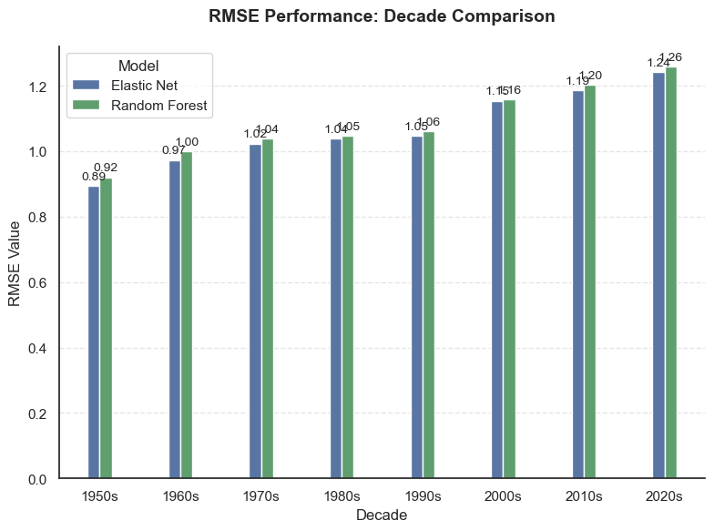

# Movie Rating Prediction Project

<div dir="rtl">

**תקציר:** חלק ב' של פרויקט כריית נתונים (שנה ג'). ניקוי והכנת נתוני סרטים, הנדסת פיצ'רים ובניית Pipelines של **Elastic Net** ו-**Random Forest** לחיזוי דירוג IMDb של סרט מנתונים הידועים לפני יציאתו. כולל ניתוח שגיאות, ניתוח הוגנות לפי ז'אנר ועשור, וחשיבות פיצ'רים.

</div>

---

> **Project series:** [Part 1 – Data collection](https://github.com/roeiraz12/Data-minning-project---3rd-year) → **Part 2 – Rating prediction (this repo)** → [Part 3 – Prediction web app](https://github.com/roeiraz12/Data-minning-project---3rd-year-part_3)

## Overview

Part 2 of a third-year Data Mining course project. The task is to predict a movie's average IMDb rating (`averageRating`) using only information that exists before the movie is released, so post-release columns such as `numVotes` and box office are dropped to prevent data leakage. A single `prepare_data()` function turns the raw movie CSV into model-ready features, and two scikit-learn pipelines – a linear model (Elastic Net) and a tree ensemble (Random Forest) – are trained, cross-validated and compared.

## What was done

1. **Data preparation (`prepare_data`)**
   - Joins directors and writers from the IMDb `title.crew` table on `tconst`.
   - Converts budget text to US dollars (currency symbols such as £, €, ₹, ¥ and units such as million, billion, crore, lakh).
   - Cleans text (Latin letters and digits only, lowercase, invisible characters removed) and unifies the many spellings of missing values (`n/a`, `none`, `-`, …).
   - Treats start years before 1900 as missing.
   - Splits list columns into separate features: `actor_1`–`actor_5`, `writer_1`–`writer_2`, `genre_1`–`genre_3`, first director.
2. **Feature engineering** – five custom features:
   - number of actors × number of genres,
   - runtime between 120 and 140 minutes (binary),
   - budget above $5M and released after 1970 (binary),
   - runtime divided by the first feature,
   - no information on both lead actor and lead writer (binary).
3. **Feature selection** – a fixed set of 20 features chosen with **Boruta**.
4. **Pipelines** – 80/20 train/test split; `ColumnTransformer` with mean/median imputation + `StandardScaler` for numeric columns and most-frequent imputation (with missing indicators) + `OneHotEncoder` (`min_frequency=20`) for categorical columns.
   - `ElasticNet(alpha=0.001, l1_ratio=0.1)`
   - `RandomForestRegressor(n_estimators=100, max_leaf_nodes=25, min_samples_leaf=15)`
5. **Evaluation** – K-fold cross-validation on the training set with R², adjusted R², MAE and RMSE.
6. **Error analysis** – the 10 largest over- and under-predictions of each model.
7. **Fairness analysis** – MAE/RMSE for the five most common genres and for each decade from the 1950s.
8. **Feature importance** – top Elastic Net coefficients and top Random Forest importances.

## Tech stack

Python · Jupyter Notebook · pandas · NumPy · scikit-learn · Boruta · matplotlib · seaborn

## Results

Cross-validation results on the training set, from the notebook output:

| Model | R² | Adj. R² | MAE | RMSE |
|---|---|---|---|---|
| **Elastic Net** | **0.2511** | **0.2481** | **0.8551** | **1.1200** |
| Random Forest | 0.2320 | 0.2288 | 0.8702 | 1.1342 |

Elastic Net did slightly better on every metric. The output is labelled "10-Fold", but the code uses `KFold(n_splits=5)`.

**Findings**

- **Genre matters most.** In both models the strongest signals are genre values: documentary pushes the predicted rating up (largest Elastic Net coefficient, +1.25 for `genre_1 = documentary`) and horror pushes it down (−1.02). In the Random Forest, `genre_1 = documentary` (0.307), `genre_1 = horror` (0.200) and runtime (0.163) are the top importances.
- **Error grows for newer movies.** Elastic Net RMSE rises from 0.89 for 1950s movies to 1.24 for 2020s movies.
- **Error differs by genre.** Among the five most common genres, Elastic Net RMSE is lowest for romance (1.01) and highest for action (1.24).
- **Hardest cases** are movies with extreme ratings (around 1 or above 9), which the models rarely see in training.



## Repository structure

| File | Description |
|---|---|
| `Notebook.ipynb` | Full workflow: data preparation, feature engineering, pipelines, cross-validation, error, fairness and feature-importance analysis |
| `report.docx` | Project report (Hebrew): column descriptions, design decisions, feature motivation, error analysis |
| `model.pkl` | Saved scikit-learn pipeline (a `HistGradientBoostingRegressor`), also used by the Part 3 web app |
| `reqirement_part2.txt` | Pinned Python environment |
| `docs/rmse_by_decade.png` | Chart from the notebook's fairness analysis |

## How to run

1. Install the dependencies: `pip install -r reqirement_part2.txt` (the list is pinned to the original Windows/Anaconda environment; installing `pandas scikit-learn Boruta ppscore matplotlib seaborn jupyter` is usually enough).
2. Put `dataset.csv` (the movie dataset; not included in this repo) and `title.crew.tsv.gz` from <https://developer.imdb.com/non-commercial-datasets/> next to the notebook.
3. Open `Notebook.ipynb` and run all cells.

---

<div dir="rtl">

## פרטים נוספים

## 🎬 Overview

פרויקט זה מתמקד בפיתוח מודלים למידת מכונה (**Elastic Net** ו-**Random Forest**) לחיזוי דירוגי סרטים ב-IMDb. הפרויקט משלב עיבוד נתונים מתקדם, סינון פיצ'רים באמצעות אלגוריתם **Boruta** ובניית Pipelines להשוואת ביצועים בין מודלים ליניאריים למודלים מבוססי עצים.

---

## 🛠️ Prerequisites

כדי להריץ את המודל בהצלחה, יש לוודא שהקבצים הבאים נמצאים בתיקיית הפרויקט:

* `dataset.csv`: קובץ הנתונים המעובד.
* `title.crew.tsv.gz`: קובץ נתוני הצוות של הסרטים.

---

## 🏗️ Model Description

המודל עובד על Pipeline מוגדר היטב:

1. **Feature Selection**: שימוש ב-Boruta לסינון משתנים רלוונטיים.
2. **Data Splitting**: חלוקת הנתונים לסט אימון (Train) ומבחן (Test) ביחס של **80/20**.
3. **Preprocessing**: טיפול בנתונים חסרים (Imputation), נרמול (Scaling) וקידוד משתנים קטגוריאליים (OneHotEncoding).

### המודלים בשימוש:

* **Elastic Net**: שילוב של L1 ו-L2 regularization למציאת מודל ליניארי אופטימלי ומזעור שגיאות.
* **Random Forest**: מודל Ensemble המבוסס על עצים להפחתת Variance ושיפור יכולת ההכללה על נתונים חדשים.

---

## 📦 Dependencies & Environment

הפרויקט מבוסס על הסביבה המפורטת להלן. ניתן להתקין את כל התלויות באמצעות הפקודה:
`pip install -r reqirement_part2.txt`

<details>
<summary>רשימת הספריות המלאה</summary>

```text
asttokens==3.0.1
beautifulsoup4==4.14.3
Boruta==0.4.3
Bottleneck==1.4.2
brotlicffi==1.2.0.0
certifi==2026.4.22
cffi==2.0.0
charset-normalizer==3.4.4
colorama==0.4.6
comm==0.2.3
contourpy==1.3.1
cycler==0.12.1
debugpy==1.8.16
decorator==5.2.1
et_xmlfile==2.0.0
exceptiongroup==1.3.0
executing==2.2.1
fonttools==4.62.1
idna==3.11
ipykernel==7.2.0
ipython==8.30.0
jedi==0.19.2
joblib==1.5.3
jupyter_client==8.8.0
jupyter_core==5.9.1
kiwisolver==1.4.9
matplotlib-inline==0.2.1
matplotlib==3.10.8
mkl-service==2.5.2
mkl_fft==2.1.1
mkl_random==1.3.0
nest-asyncio==1.6.0
numexpr==2.14.1
numpy==2.2.5
openpyxl==3.1.5
packaging==26.0
pandas==2.3.3
parso==0.8.5
patsy==1.0.2
pillow==12.1.1
pip==26.0.1
platformdirs==4.9.4
ppscore==1.3.1
prompt_toolkit==3.0.52
psutil==7.0.0
pure_eval==0.2.3
pycparser==3.0
Pygments==2.20.0
pyparsing==3.2.5
PyQt5==5.15.11
PyQt5_sip==12.17.0
PySocks==1.7.1
python-dateutil==2.9.0.post0
pytz==2026.1.post1
pywin32==311
pyzmq==27.1.0
requests==2.33.1
scikit-learn==1.7.2
scipy==1.15.3
seaborn==0.13.2
setuptools==82.0.1
sip==6.12.0
six==1.17.0
soupsieve==2.5
stack_data==0.6.3
statsmodels==0.14.6
threadpoolctl==3.6.0
tomli==2.4.0
tornado==6.5.5
tqdm==4.67.3
traitlets==5.14.3
typing_extensions==4.15.0
tzdata==2025.3
urllib3==2.6.3
wcwidth==0.2.14
wheel==0.46.3
win_inet_pton==1.1.0

```

</details>

---

*פרויקט זה פותח כחלק מקורס Data Mining, שנה ג'.*

</div>
